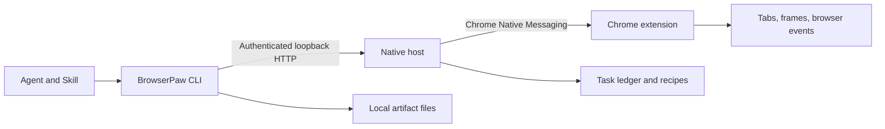

# BrowserPaw architecture

The shared command registry defines CLI option parsing and documentation. Native maps validated commands to the existing task manager and deterministic browser operations. The extension owns indexing, strict locator resolution, document and capture identity, native input, and file and download events.

Chrome starts the registered host. The host binds to loopback, publishes its port in `host.json`, and authenticates commands with the local token. Request cancellation reaches the existing extension cancellation path. Browser identity and action receipts control task cleanup and handling of uncertain outcomes.

Build output for v5 lives in `app/native-server/dist/v5`. The npm package includes separate CLI and host bundles, platform wrappers, the unpacked extension and the canonical Skill. Setup stores the host independently of npm's execution cache.
