# BrowserPaw Documentation Hub 📚

BrowserPaw connects agents to an existing Chrome session through a local MCP bridge.

This hub serves as the definitive reference guide for AI Agents (Claude Code, Cursor, Windsurf, Codex) and human engineers.

For development, start with [PROJECT.md](../PROJECT.md) and [development boundaries/current work](./development/DEVELOPMENT.md). Acceptance belongs to [QUALITY.md](./QUALITY.md); document ownership belongs to [DOCUMENTATION.md](./DOCUMENTATION.md). BrowserPaw 4.1.2 is the latest published tag. Historical milestone tables are not current acceptance claims.

---

## 🗺️ Documentation Architecture & Quick Navigation

```mermaid
graph TD
    Root[BrowserPaw Root] --> Guides[Quickstart & Guides]
    Root --> CoreDocs[Technical Docs /docs]
    Root --> Archive[Historical Archive]

    Guides --> RootReadme["README.md (Overview & Quickstart)"]
    Guides --> Install["INSTALL.md (Setup & Native Host)"]
    Guides --> Project["PROJECT.md (Engineering Specs & Gates)"]
    Guides --> AgentConfig["AGENT_CONFIG_GUIDE.md (MCP Client Setup)"]
    Guides --> TestInfra["TEST_INFRA.md (E2E Test Matrix)"]

    CoreDocs --> Arch["ARCHITECTURE.md (Dual-Brain & CDP Engine)"]
    CoreDocs --> Tools["TOOLS.md (Canonical 50-Tool Reference)"]
    CoreDocs --> Map["MAP.md (Codebase Symbols & Dataflows)"]
    CoreDocs --> Config["mcp-cli-config.md (CLI & Stdio Settings)"]
    CoreDocs --> Troubleshoot["TROUBLESHOOTING.md (Diagnosis & Fixes)"]
    CoreDocs --> Contribute["CONTRIBUTING.md (PRs & Code Standards)"]

    Archive --> Releases["archive/releases/ (Past Release Notes)"]
    Archive --> Handoffs["archive/handoffs/ (Refactor Phase Notes)"]
    Archive --> Reviews["archive/reviews/ (Audit & Security Reports)"]
    Archive --> Testing["archive/testing/ (Historical Test Records)"]
```



---

## 📑 Core Documentation Index

### 1. Architectural & Engineering References

| Document                                                               | Purpose                                         | Key Content                                                                                                                                                                                          |
| :--------------------------------------------------------------------- | :---------------------------------------------- | :--------------------------------------------------------------------------------------------------------------------------------------------------------------------------------------------------- |
| [**`QUALITY.md`**](./QUALITY.md)                                       | **Engineering Quality & Verification Contract** | Single canonical contract for acceptance: pnpm verify, build:deploy, verify:delivery, and runtime identity evidence standards.                                                                       |
| [**`DOCUMENTATION.md`**](./DOCUMENTATION.md)                           | **Documentation Governance & Architecture**     | Single source of truth for doc ownership, active vs. archived partitions, English/Chinese translation policy, and release templates.                                                                 |
| [**`PLUGIN_COMPATIBILITY.md`**](./development/PLUGIN_COMPATIBILITY.md) | **Host Plugin Contracts**                       | Canonical skill, portable ChatGPT/Codex plugin, native Hermes plugin, Claude Code plugin, DSH Cordis bundle, official-source verification and remaining runtime limits.                              |
| [**`ARCHITECTURE.md`**](./ARCHITECTURE.md)                             | **Technical Architecture Specification**        | Architecture baseline and historical design decisions; current ownership and acceptance boundaries live in PROJECT and development work.                                                             |
| [**`TOOLS.md`**](./TOOLS.md)                                           | **Canonical Tool Matrix & API Contracts**       | Complete parameter schemas, profiles, and input commitment contracts across the canonical MCP tools (DOM-first perception, batch pipeline, form automation, media inspection, and computer actions). |
| [**`MAP.md`**](./MAP.md)                                               | **Codebase Map & Dataflows**                    | Monorepo symbol indexes, inter-package dependencies, IPC Native Messaging framing protocols, and background service worker lifecycle maps.                                                           |

---

### 2. Operations, Configuration & Diagnostics

| Document                                                     | Purpose                                 | Key Content                                                                                                                        |
| :----------------------------------------------------------- | :-------------------------------------- | :--------------------------------------------------------------------------------------------------------------------------------- |
| [**`mcp-cli-config.md`**](./mcp-cli-config.md)               | **MCP Client Configuration Matrix**     | Configuration templates (`claude_desktop_config.json`, `.cursor/mcp.json`, Windsurf, Codex) for Stdio and HTTP transport modes.    |
| [**`TROUBLESHOOTING.md`**](./TROUBLESHOOTING.md)             | **Troubleshooting & Diagnostics Guide** | Solutions for native host connection drops, CDP attachment limits, GPU VRAM allocation, and permission resolution. _(English)_     |
| [**`TROUBLESHOOTING.zh-CN.md`**](./TROUBLESHOOTING.zh-CN.md) | **Chinese Diagnostics Manual**          | Step-by-step diagnostic workflows for domestic registry mirrors, CUDA environments, and native messaging connectivity. _(Chinese)_ |
| [**`CONTRIBUTING.md`**](./CONTRIBUTING.md)                   | **Contribution & Development Guide**    | Monorepo development workflows, conventional commits, linting rules, Vitest/Jest test suites, and pull request quality gates.      |

---

### 3. Root Level Guides (User-Facing)

| Document                                                                             | Purpose                                                                                                                |
| :----------------------------------------------------------------------------------- | :--------------------------------------------------------------------------------------------------------------------- |
| [**`README.md`**](../README.md) / [**`README.zh-CN.md`**](../README.zh-CN.md)        | Monorepo homepage, installation routes (Zero-Compile ZIP vs Source build), feature showcases, and quick start.         |
| [**`INSTALL.md`**](../INSTALL.md)                                                    | Comprehensive step-by-step setup guide for native host registration, extension installation, and silent debugger mode. |
| [**`PROJECT.md`**](../PROJECT.md) / [**`PROJECT.zh-CN.md`**](../PROJECT.zh-CN.md)    | Monorepo engineering specifications, quality gates, and code contracts.                                                |
| [**`AGENT_CONFIG_GUIDE.md`**](../AGENT_CONFIG_GUIDE.md)                              | Ready-to-copy configuration snippets for all major AI coding agents.                                                   |
| [**`TEST_INFRA.md`**](../TEST_INFRA.md)                                              | Comprehensive 4-tier E2E testing framework, mock server setup, and test runner architecture.                           |
| [**`CHANGELOG.md`**](../CHANGELOG.md) / [**`docs/releases/`**](./releases/README.md) | Centralized release ledger, per-version changelogs for every local git tag, and unreleased change tracker.             |

---

### 4. Development, Research & Deep Dives (`docs/development/`)

| Document                                                                                                         | Purpose                             | Key Content                                                                                                                                                                                                       |
| :--------------------------------------------------------------------------------------------------------------- | :---------------------------------- | :---------------------------------------------------------------------------------------------------------------------------------------------------------------------------------------------------------------- |
| [**`persistent-repl.zh-CN.md`**](./development/persistent-repl.zh-CN.md)                                         | **Persistent Node REPL Guide**      | Interactive local REPL workflow preserving variables, top-level await, and MCP client reuse for low-overhead multi-turn automation. _(Chinese)_                                                                   |
| [**`browserpaw-blueprint-implementation.zh-CN.md`**](./development/browserpaw-blueprint-implementation.zh-CN.md) | **Blueprint Implementation Ledger** | M0-M7 implementation status, verified behavior, runtime gaps, and release gates. _(Chinese)_                                                                                                                      |
| [**`browser-task-suite.json`**](./development/browser-task-suite.json)                                           | **Fixed M7 Task Suite**             | 80 distinct inputs across four families, rotated batches, cold/reuse/recovery modes, and machine-readable measurement contracts.                                                                                  |
| [**`three-browser-comparison-2026-10-22.zh-CN.md`**](./development/three-browser-comparison-2026-10-22.zh-CN.md) | **Three-Browser Capability Matrix** | Current Ego, Aside, and BrowserPaw capability matrix separating source regressions, live-build evidence, historical state, and closed-source unknowns, including M0-M6 status and M7 acceptance gaps. _(Chinese)_ |

---

### 5. 📦 Archive Directory (`docs/archive/`)

Historical records, phased handoffs, and audit logs are preserved in [`docs/archive/`](./archive/) to keep the active documentation clean and decluttered:

- [**`docs/releases/`**](./releases/): Versioned release records and the canonical change history.
- [**`archive/handoffs/`**](./archive/handoffs/): Milestone handoff records and refactor phase notes.
- [**`archive/testing/`**](./archive/testing/): Historical manual testing notes and edge-case execution logs.
- [**`archive/reviews/`**](./archive/reviews/): Deep code reviews, security audits, and dependency evaluations from September 2026.

---

## 🛠️ Monorepo Commands Reference

```bash
# Full static quality & build verification gate (14-step audit)
pnpm verify

# Run simulated in-memory CDP E2E suite
pnpm test

# Typecheck workspaces (0 errors required)
pnpm typecheck

# Build production extensions and native bridge
pnpm build

# Build and stage extension artifacts for deployment
pnpm build:deploy

# Verify deployed artifact integrity and source hash parity
pnpm verify:delivery
```
